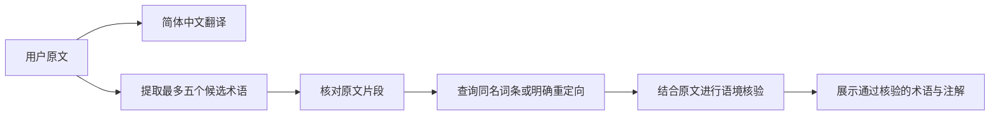

<div align="center">

# 🌐 Auto Translator

### 读懂原文，也读懂专业名词。

将多种语言文本翻译为简体中文，并为通过核验的专业名词提供中文维基百科参考。

[](https://auto-translator-5cugkhgnkmabkiz6yeb8fk.streamlit.app/)
[](https://streamlit.io/)
[](https://www.langchain.com/)

[功能亮点](#功能亮点) · [开始使用](#开始使用) · [本地运行](#本地运行) · [术语如何核验](#术语如何核验) · [常见问题](#常见问题)

</div>

---

## 项目介绍

**Auto Translator** 是一个基于 **Streamlit + LangChain** 的轻量翻译应用，适合阅读外文资料、论文摘要和技术说明。

在左侧粘贴原文，在右侧查看简体中文译文；遇到专业名词，还可以展开下方的百科注解，查看原文术语、对应词条和来源链接。

你可以使用自己的 **Kimi、千问、DeepSeek、OpenAI** 模型配置，也可以连接提供 OpenAI 兼容接口的第三方服务。

> **自带 API 配置即可使用。** API 密钥、API 基础地址和模型名称均由用户填写，应用不提供公共模型额度。

## 功能亮点

| 功能 | 说明 |
| :--- | :--- |
| 🌏 多语言翻译 | 无需手动选择原文语言，目标语言固定为简体中文 |
| ↔️ 双栏对照 | 原文在左、译文在右，多行文本框支持滚动阅读 |
| 🔌 自选模型 | 支持配置 API 密钥、基础地址和模型名称 |
| 📖 翻书动画 | 等待时在文本框上方显示小型翻书动画和翻译提示 |
| 🔎 术语核验 | 检查原文片段、百科标题关系和释义语境，过滤未通过的候选 |
| 🔗 来源可查 | 注解附原文术语、实际百科标题和对应词条链接 |
| 📥 译文下载 | 将译文保存为 UTF-8 编码的 `.txt` 文件 |
| 📝 中文注释 | Python 代码逐行配有中文注释，方便学习和修改 |

## 开始使用

**[点击打开在线应用 →](https://auto-translator-5cugkhgnkmabkiz6yeb8fk.streamlit.app/)**

1. 在左侧栏填写 **API 密钥**、**API URL** 和 **模型名称**。
2. 在“原文”区域输入或粘贴待翻译文本。
3. 点击 **翻译成简体中文**，等待翻译和术语核验完成。
4. 在右侧查看译文，按需复制或点击 **下载译文**。
5. 展开 **维基百科搜索结果**，查看通过核验的专业名词及来源。

### API 配置说明

| 配置项 | 应填写的内容 |
| :--- | :--- |
| API 密钥 | 当前服务商或网关颁发的有效密钥 |
| API URL | OpenAI 兼容接口的**基础地址** |
| 模型名称 | 对应平台支持、且当前账号有权调用的模型 ID |

**API URL 需要填写接口地址，不是开发者网站或控制台首页。**

例如，使用 Kimi 国内开放平台时，基础地址填写 `https://api.moonshot.cn/v1`；`https://platform.kimi.com` 是开发者网站，不能作为模型调用地址。模型名称以当前平台提供的列表为准。

第三方服务需要兼容 OpenAI Chat Completions 接口；仅替换 URL 并不能使任意协议都自动兼容。密钥、地址和模型名称应来自同一个平台或网关。

## 本地运行

### 1. 获取项目

```bash
# 克隆项目到本地。
git clone https://github.com/wuchongzhi/auto-translator.git

# 进入项目文件夹。
cd auto-translator
```

也可以在仓库首页选择 **Code → Download ZIP**，解压后进入项目文件夹。

### 2. 安装依赖

使用你准备运行项目的 Python 环境安装依赖。已有 `demo1` 环境时，可以执行：

```bash
# 激活已有的 Conda 环境。
conda activate demo1

# 通过当前环境的 Python 安装项目依赖。
python -m pip install -r requirements.txt
```

如果使用其他虚拟环境，激活对应环境后执行相同的依赖安装命令即可，不要求环境必须叫 `demo1`。

### 3. 启动页面

```bash
# 使用当前环境的 Streamlit 启动前端。
python -m streamlit run main.py
```

启动后，打开终端显示的本地访问地址。保持 `main.py`、`utils.py` 和 `loading.html` 位于同一个文件夹。

## 术语如何核验

百科注解采用以下流程：



每个最终展示的术语，都需要经过以下检查：

1. **原文对应**：模型提供的原文术语片段确实出现在输入文本中。
2. **标题对应**：百科返回同名词条，或可追踪的标题规范化、繁简转换及重定向关系。
3. **含义对应**：将原文、中文译名和百科摘要交给模型批量核验，排除跨领域同名或只存在相关性的候选。

没有找到对应词条、命中歧义页面、查询失败或未通过语境核验的候选，不进入最终术语列表。百科注解使用词条返回的真实导言，经繁简转换后展示。

> 这是一种偏保守的筛选方式：部分有效术语可能因为百科未收录、名称差异或核验失败而被过滤。模型的语义判断仍可能出错，重要内容应结合原文和来源复核。

## 项目结构

```text
auto-translator/
├── main.py             # Streamlit 页面、输入检查与结果展示
├── utils.py            # LangChain 翻译、术语提取与百科核验
├── loading.html        # 本地翻书动画与等待提示
├── requirements.txt    # Python 依赖清单
└── README.md           # 项目介绍与使用说明
```

## 部署到 Streamlit Cloud

1. 将上述文件提交到 GitHub 仓库，并保持依赖清单与入口文件同级。
2. 登录 [Streamlit Community Cloud](https://share.streamlit.io/)。
3. 创建应用，选择仓库 `wuchongzhi/auto-translator` 和部署分支。
4. 将入口文件设为 `main.py`，开始部署并等待依赖安装完成。
5. 打开应用，在侧边栏填写自己的模型配置。

云端使用独立的 Python 环境，本地安装过的库不会自动同步过去。部署依赖通过 `requirements.txt` 安装。

## 常见问题

<details>
<summary><b>为什么出现 HTTP 404？</b></summary>

通常需要检查 API URL 或模型名称。确认填写的是模型 API 基础地址，且该地址支持当前模型。开发者网站首页不能代替 API 地址。

</details>

<details>
<summary><b>为什么有译文，却没有专业名词注解？</b></summary>

输入中可能没有合适的术语，也可能是百科没有对应词条、网络请求失败或候选没有通过核验。应用会保留译文，并过滤无法确认的候选，不强行补充注解。

</details>

<details>
<summary><b>为什么翻译需要等待一段时间？</b></summary>

应用需要进行翻译、候选术语提取和百科查询；取得可用词条后，还会额外调用一次模型进行批量语境核验。等待时间受所选模型、文本长度、网络和部署资源影响，多次模型调用也会使用对应平台的额度。

</details>

<details>
<summary><b>可以直接上传 PDF、图片或文档吗？</b></summary>

当前版本支持文字输入和粘贴，不包含文件上传、OCR 或 PDF 解析。输入长度仍需在所选模型支持的范围内，当前没有自动长文本分块功能。

</details>

## 数据与使用说明

- 输入文本会发送到你配置的模型服务，语境核验也会使用原文与候选百科摘要。
- 中文术语名称会用于访问中文维基百科，查询需要网络可用。
- API 密钥使用密码框输入，当前代码未主动将其写入项目文件；不要把真实密钥提交到 GitHub。
- 翻译结果保存在当前 Streamlit 会话中，下载文件由用户主动触发；刷新或会话结束后，结果可能清空。
- 译文和百科注解用于辅助理解，准确性取决于原文、模型与来源内容。

## 反馈与交流

欢迎通过 [Issues](https://github.com/wuchongzhi/auto-translator/issues) 提交问题和改进建议。

报告问题时，可以说明复现步骤、模型名称和错误提示。请移除 API 密钥、个人信息及敏感原文。

---

<div align="center">

由 [wuchongzhi](https://github.com/wuchongzhi) 开发 · 基于 Streamlit 与 LangChain

**让阅读跨过语言，也让术语有据可查。**

</div>
